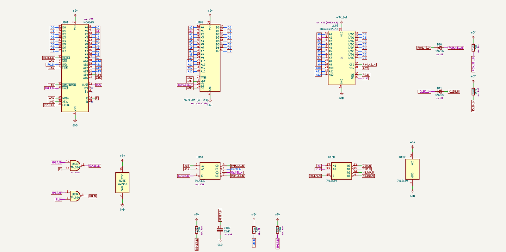
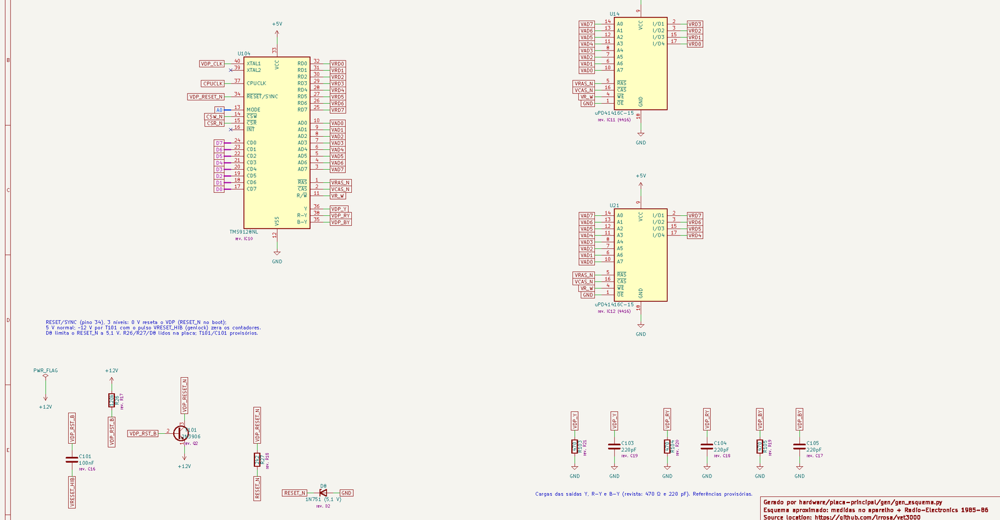
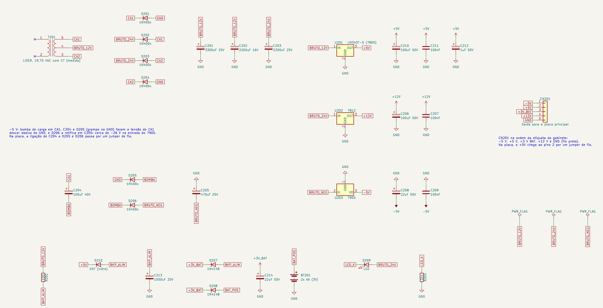

# Placa principal e fonte do VET 3000: esquema aproximado (KiCad)

Esquema da placa principal `VET 30 VS1 REV. 2` em KiCad 10. O circuito junta duas fontes:

- as **medidas de continuidade** feitas no aparelho ([CN1](../../docs/conector-cn1.md),
  [teclado](../../docs/teclado.md), U19, `/INT`) e as referências e valores lidos nas
  [fotos](../../photos/);
- o **"Build This Video Titler"** da *Radio-Electronics* (dezembro de 1985 e janeiro de 1986), de
  onde o VET deriva ([origem.md](../../docs/origem.md)).

Esta primeira versão cobre a **parte digital**: CPU, memórias, decodificação, VDP e VRAM, teclado e
CN1. A parte analógica (PLL do clock, sincronismo, croma e mixer) aparece como um bloco com os sinais
que cruzam a fronteira. A folha **Fonte** traz a placa da fonte, que não está na revista: as ligações
dela foram levantadas das fotos dos dois lados da placa (ver [Fonte](#fonte)).

Copyright © 2026 Leonardo Roman da Rosa. Hardware aberto sob a **CERN-OHL-S-2.0** (ver
[Licença](#licença)).

| CPU, memórias e decodificação | VDP e VRAM |
|---|---|
|  |  |

## Arquivos

| Arquivo | Conteúdo |
|---|---|
| `vet3000_placa.kicad_pro/.kicad_sch` | Projeto e folha raiz (visão geral, legenda, notas) |
| `cpu.kicad_sch` | 6809, EPROM, RAM, 74LS139, 74LS00, OU com diodos de ROM SEL e I/O SEL, reset |
| `video.kicad_sch` | TMS9128, duas µPD41416, RESET/SYNC de 3 níveis, cargas das saídas Y/R-Y/B-Y |
| `teclado.kicad_sch` | 74LS273, 74LS244, pull-ups e conector das membranas |
| `conectores.kicad_sch` | CN1, alimentação e desacoplamento |
| `analogico.kicad_sch` | Bloco provisório da parte analógica |
| `fonte.kicad_sch` | Placa da fonte: ponte, 7805, 7812, 7905 com bomba de carga, backup da RAM, conector de saída |
| `vet3000_placa.kicad_sym` | Símbolos próprios: TMS9128, µPD41416, `+3V_BAT` e o bloco analógico |
| `vet3000_placa.pdf` | O esquema em PDF |
| [`continuidade.md`](continuidade.md) | Roteiro de continuidade: cada rede, pino a pino, marcada como medida ou a medir |
| `gen/gen_esquema.py` | Gera tudo acima (ver [Regenerar](#regenerar)) |

ERC sem violações. Dois avisos ficam desligados no projeto enquanto a parte analógica não existe:
unidades não posicionadas e pinos de entrada em unidades não posicionadas (portas b e c do U23).

## Como ler

- **Cores das redes.** Azul: todas as ligações da rede foram medidas no aparelho. Roxo: parte delas
  foi medida, o resto segue a revista. Cor padrão do KiCad (rótulo vermelho-escuro, fio fino): só
  segundo a revista (na fonte, segundo as fotos), ainda a medir. As cores vêm das classes de rede
  `Medido` e `Parcial` do projeto.
- **Rótulos.** Toda rede é ligada por rótulos globais, inclusive as internas a uma folha. A
  alimentação usa símbolos nos pinos de cima e de baixo e rótulos (`+5V`, `GND`) nos pinos laterais.
- **Referências.** U14, U15, U16, U21, U22, U23, D8, D10, D11, R26-R30, R48, R49, R52-R59 e os
  conectores CN1 (traseiro), CN2 (entrada da fonte) e CN3 (teclado) são os da placa. **U101-U104**
  (6809, EPROM, RAM, VDP), **T101**, **C101-C114**, **R103-R105** e **#BLK1** são provisórias: as
  referências da placa não aparecem nas fotos. Na placa ainda
  não foram localizados U5, U6, U11, U12 e U18, e entre eles devem estar esses quatro CIs e o LM1889.
  Já identificados na parte analógica: U1 = MC4024, U7 = MC4044, T4 = transistor do PLL. Na fonte,
  todas as referências (U201-U203, D201-D210, C201-C214, R201, R203, T201, BT201 e CN201) são
  provisórias: a placa não tem serigrafia de componentes.
- **Campo "rev."** Cada peça mostra o equivalente na revista (por exemplo, U15 = IC18).

## Medido e a verificar

O roteiro completo está em [continuidade.md](continuidade.md): 40 redes totalmente medidas, 6
parcialmente e 37 só da revista, mais 9 redes internas da fonte, levantadas das fotos. Pontos que
mais pedem conferência:

1. **D10/R48 e D11/R49.** A atribuição à ROM (D10/R48) e à E/S (D11/R49) segue a posição na placa.
   O CN1 a11 foi medido no pino 6 do U15, antes do diodo; na revista a porta usava o pino 15.
2. **`/OE` da RAM** pela porta NAND do U23 (`/HALT` com `R/W`), segundo a revista.
3. **U14 e U21.** Qual DRAM recebe RD0-RD3 e qual recebe RD4-RD7.
4. **Reset.** R28 (5k1) com um eletrolítico de 22 µF (C102, provavelmente o "C2?" ao lado do D8);
   T101 e C101 do RESET/SYNC do VDP.
5. **Desacoplamento.** Valores e posições da revista.

Já confirmados: todo o barramento de endereços e de dados entre CPU, EPROM, RAM, VDP, CN1 e os CIs
do teclado (U16 e U22, com os mesmos pinos da revista), as seleções do 74LS139 que chegam ao CN1 e a
ausência de ligação entre o `/INT` do VDP e o `/IRQ` do 6809. Também medidos: R30 é o pull-up do
`/HALT` e R29 o do `/IRQ`; o `/OE` da EPROM (pino 22) e os das duas µPD41416 (pino 1) vão ao GND; e
o teclado inteiro. O `/CLR` do U16 vai ao +5 V, a seleção vem do U15 (pino 10 ao clock do U16,
pino 9 aos enables do U22), e o conector CN3 liga cada trilha ao U16, ao U22 e aos pull-ups R52-R59.
No CN3, o pino 1 fica embaixo à esquerda: os ímpares (fileira de baixo) são a membrana inferior
(linhas) e os pares (fileira de cima), a superior (colunas).

O CN2, entrada da fonte na placa principal, tem a ordem inversa da do CN201 da placa da fonte: GND
no pino 1, depois +12 V, +3 V BAT, +5 V e −5 V no pino 5 (medido).

## Fonte

A fonte fica numa placa separada, sem serigrafia de componentes, ligada ao CN2 da placa principal por
um conector de 5 vias: −5 V, +5 V, +3 V BAT, +12 V e GND (fio preto), na ordem da etiqueta do gabinete.
No CN2 a ordem é a inversa: GND no pino 1 e −5 V no pino 5.
A folha `fonte.kicad_sch` foi levantada das fotos dos dois lados da placa e ainda não tem ligações
medidas.



- **Retificação.** O transformador LIDER tem secundário com derivação central (CT), com 19,75 VAC
  medidos entre as pontas. A ponte D201-D204 usa o próprio negativo como GND, então o CT fica em
  cerca de +12 V (`BRUTO_12V`, com C201 de 3300 µF, fora da placa, e C202 de 2200 µF) e o positivo
  da ponte em cerca de +24 V (`BRUTO_24V`, com C203 de 2200 µF). Sem carga, as contas dão uns
  13 V e 26,5 V.
- **+5 V.** U201, um LM340T-5 (7805), fica fora da placa num dissipador e é alimentado pelo
  `BRUTO_12V`. Fios: amarelo = entrada, azul = GND, laranja = saída. Ele está montado com as pernas
  para cima, e nessa posição o pino da esquerda é a saída.
- **+12 V.** U202 (7812), alimentado pelo `BRUTO_24V`.
- **−5 V.** U203 (7905), alimentado por uma bomba de carga numa das pontas do secundário (C204, D205
  e D206), que deixa cerca de −26 V em C205 sem carga.
- **+3 V BAT.** OU com diodos 1N4148. Desligado, vem das duas pilhas AA (BT201) por D208. Ligado,
  vem de `BKP_ALIM` por D207: R201 (100 Ω) leva corrente do `BRUTO_12V` a `BKP_ALIM`, e o diodo D210
  a segura uma queda de diodo acima do +5 V (cerca de 5,6 V). Assim a RAM recebe uns 5 V, a mesma
  tensão da lógica.
- **LED do painel.** Provavelmente alimentado pelo `BRUTO_24V`, com R203 (2k4) para o GND.

A tabela [Peças da fonte](continuidade.md#peças-da-fonte) do roteiro diz onde fica cada peça na placa
e o valor lido. Falta a medição das ligações.

Neste aparelho, o D210 (1N4148) estava aberto e foi trocado, junto com D207, D208, C203, C205 e R201.
Depois do conserto, sem a placa principal e sem pilhas:

| Saída | Carga de teste | Medido |
|---|---|---|
| +5 V | 50 Ω | 5,04 V |
| −5 V | 100 Ω | −5,06 V (sem carga, −6,57 V) |
| +3 V BAT | nenhuma | 5,65 V |

Sem carga, o C214 (22 µF) guarda a tensão de testes anteriores e só descarrega pela entrada do
multímetro: a leitura do +3 V BAT começou em 9,5 V e desceu devagar até os 5,65 V. Com a fonte ligada
à placa principal, o VET liga e mostra a abertura.

**Ao testar a fonte sozinha, ponha uma carga no +5 V.** A corrente de R201, cerca de 60 mA, passa por
D210 e entra na linha de +5 V. Com a placa principal ligada, ela some no consumo da placa. Sem carga,
não tem para onde ir, porque o 7805 só fornece corrente (não absorve), e a linha de +5 V sobe para uns
11 V. Para ver a tensão regulada, a carga tem que puxar mais do que a corrente do R201: um resistor
de 47 Ω (1 W), ou dois de 100 Ω em paralelo, entre +5 V e GND. Com um só de 100 Ω (50 mA) a linha
ainda fica em uns 5,7 V. Se D210 abrir, acontece o contrário: o +5 V fica normal, mas o +3 V BAT
sobe para uns 12 V e queima a RAM.

Pontos fracos do projeto: sem carga, C203 e C205 (25 V) trabalham acima do limite e deveriam ser de
35 V; R201 dissipa cerca de 0,5 W e precisa ser de pelo menos 1 W.

## Próximos passos

- medir as ligações marcadas com `·` no roteiro e atualizar `MEASURED` em `gen/gen_esquema.py`;
- ler os valores da fonte marcados com `?` e medir as ligações dela;
- desenhar a parte analógica a partir das Figs. 7, 8, 11 e 13 da revista, com U1, U7, T4, U19
  (CA3126) e os demais já identificados;
- localizar as referências que faltam (U5, U6, U11, U12, U18 e os passivos do reset e do vídeo).

## Regenerar

```bash
python gen/gen_esquema.py
kicad-cli sch erc --severity-all vet3000_placa.kicad_sch
kicad-cli sch export pdf -o vet3000_placa.pdf vet3000_placa.kicad_sch
```

O script recria as folhas, a biblioteca de símbolos, o `.kicad_pro` (a partir do modelo do KiCad) e
o `continuidade.md`. Alterações feitas à mão no KiCad são perdidas: mude as tabelas do script.

## Licença

Copyright © 2026 Leonardo Roman da Rosa.

Esta fonte descreve Hardware Aberto e é licenciada sob a CERN-OHL-S v2 ([LICENSE](LICENSE)). Você
pode redistribuir e modificar esta fonte e fabricar produtos com ela nos termos da CERN-OHL-S v2
(https://ohwr.org/cern_ohl_s_v2.txt).

Esta fonte é distribuída SEM QUALQUER GARANTIA EXPRESSA OU IMPLÍCITA, INCLUSIVE DE
COMERCIABILIDADE, QUALIDADE SATISFATÓRIA E ADEQUAÇÃO A UM FIM ESPECÍFICO. Veja as condições
aplicáveis na CERN-OHL-S v2.

Source location: https://github.com/lrrosa/vet3000

A licença vale para os arquivos desta pasta: o desenho do esquema, a biblioteca de símbolos, o
roteiro de continuidade e os scripts de `gen/`. O circuito documentado é o do VET 3000 (TMS) e do
projeto de Jack Flack publicado na *Radio-Electronics*, e esta licença não concede direitos sobre
eles.
